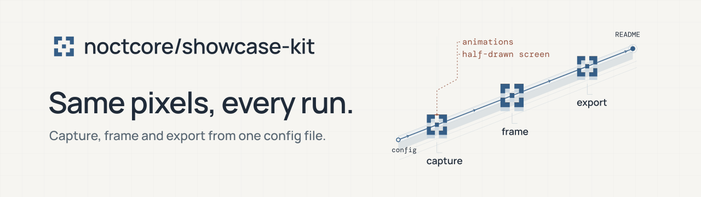

<div align="center">
  <picture>
    <source media="(prefers-color-scheme: dark)" srcset="assets/brand/readme-header-dark.svg">
    <source media="(prefers-color-scheme: light)" srcset="assets/brand/readme-header-light.svg">
    
  </picture>

  <p><strong>Capture, frame and export showcase images of web, Electron and terminal apps for READMEs and portfolios, from one config file.</strong></p>

  <p>
    <a href="https://github.com/noctcore/showcase-kit/actions/workflows/ci.yml"></a>
    <a href="https://github.com/noctcore/showcase-kit/actions/workflows/docs.yml"></a>
    <a href="https://www.npmjs.com/package/@noctcore/showcase-kit"></a>
    
    <a href="LICENSE"></a>
  </p>

  <p>
    <a href="https://noctcore.github.io/showcase-kit/"><strong>Docs</strong></a>
    &nbsp;·&nbsp;
    <a href="https://noctcore.github.io/showcase-kit/gallery/"><strong>Gallery</strong></a>
    &nbsp;·&nbsp;
    <a href="https://noctcore.github.io/showcase-kit/reference/config/"><strong>Config reference</strong></a>
    &nbsp;·&nbsp;
    <a href="CONTRIBUTING.md"><strong>Contributing</strong></a>
    &nbsp;·&nbsp;
    <a href="SECURITY.md"><strong>Security</strong></a>
  </p>
</div>

## What it does

Screenshots in a README go stale every time the UI changes, and retaking them by hand never gives the
same crop twice. One config file describes your app and the views worth showing. The `showcase` CLI
drives the app with [Playwright](https://playwright.dev) (a web app in headless Chromium, an Electron
app over the Chrome DevTools Protocol, or a terminal app in a pseudo terminal), settles each view and
captures the same pixels on every run. Before the shutter it turns off motion, zeroes transitions,
finishes or resets animations, hides the caret and waits for fonts; a terminal app gets a fixed size, `TZ=UTC`,
a fixed locale and a bundled font.

From one config it produces:

- **raw captures**: pixel-exact PNGs at a fixed viewport and device scale factor, in every UI language;
- **framed README images**: each capture in a window, browser or terminal frame (six styles) on a solid, gradient,
  mesh, dotted, grainy or transparent background, as WebP or PNG;
- **portfolio images**: exact-size 16:9 images with the framed window contained, a thumbnail and a gallery JSON;
- **a README snippet**: the framed images with captions as HTML, in one of five layouts (a table, rows, a featured
  image, collapsible details or a list);
- **a hero banner**: logo, name, tagline and framed shots in one of six layouts (stack, spotlight, split, row,
  mosaic or centered);
- **terminal clips**: animated WebP and GIF recordings of a terminal app (MP4 opt-in);
- **app icons**: web, Electron or Tauri icon sets from one square image.

## Gallery

Four of the outputs, rendered for Nightjar, a made-up app the [docs gallery](https://noctcore.github.io/showcase-kit/gallery/)
captures (not the kit's own UI). `showcase readme` printed this table; the gallery has every layout, frame style and
background with the config that made it.

<table>
  <tr>
    <td width="50%"></td>
    <td width="50%"></td>
  </tr>
  <tr>
    <td align="center"><sub>Hero: spotlight</sub></td>
    <td align="center"><sub>Hero: row</sub></td>
  </tr>
  <tr>
    <td width="50%"></td>
    <td width="50%"></td>
  </tr>
  <tr>
    <td align="center"><sub>Hero: mosaic</sub></td>
    <td align="center"><sub>Frame: browser</sub></td>
  </tr>
</table>

## Install

```sh
pnpm add -D @noctcore/showcase-kit playwright
npx playwright install chromium
```

(`npm i -D` and `bun add -d` work the same.) Requires Node 22 or newer and Playwright 1.50 or newer. Terminal
apps also need `@lydell/node-pty`.

## Quick start

```sh
npx showcase init     # writes showcase.config.mjs (--ts for TypeScript, --tty for a terminal app)
# set target.url (and target.start, if the kit should start your dev server), then the shots
npx showcase all      # capture, frame, and export the portfolio images when configured
npx showcase readme   # print the README snippet (--layout for the others)
```

`showcase all` writes the raw captures to `showcase-out/raw/en/` and the framed images to
`assets/showcase/en/`; `showcase readme` prints the HTML table that shows them. A minimal config for a web app:

```js
// showcase.config.mjs
import { defineConfig } from '@noctcore/showcase-kit';

export default defineConfig({
  name: 'My App',
  target: { mode: 'url', url: 'http://localhost:5173', start: 'pnpm dev' },
  ready: '#root > *',
  shots: [
    { id: 'dashboard', title: 'Dashboard', nav: '/' },
    { id: 'reports', title: 'Reports', nav: '/reports', waitFor: '[data-testid="chart"]' },
  ],
});
```

## Documentation

| Page | What it covers |
| --- | --- |
| [Getting started](https://noctcore.github.io/showcase-kit/getting-started/) | Prerequisites, install, `init`, your first images, where the files land |
| [Gallery](https://noctcore.github.io/showcase-kit/gallery/) | Real outputs the kit produced from a fixture app |
| [Web apps](https://noctcore.github.io/showcase-kit/guides/web-apps/) | url mode: start commands, `ready`, shots and `nav`, languages, deterministic captures |
| [Electron](https://noctcore.github.io/showcase-kit/guides/electron/) | cdp mode: attaching to a running Electron app |
| [Tauri](https://noctcore.github.io/showcase-kit/guides/tauri/) | The web build on any OS, or WebView2 over CDP on Windows |
| [Terminal apps](https://noctcore.github.io/showcase-kit/guides/terminal-apps/) | tty mode: TUIs and CLIs in a pseudo terminal |
| [Terminal determinism](https://noctcore.github.io/showcase-kit/guides/terminal-determinism/) | What the kit pins down, and what a TUI should offer |
| [Clips](https://noctcore.github.io/showcase-kit/guides/clips/) | Animated recordings of a terminal app |
| [Frames](https://noctcore.github.io/showcase-kit/guides/frames/) | Window styles, backgrounds, formats and sizes |
| [README table](https://noctcore.github.io/showcase-kit/guides/readme-table/) | `showcase readme`, its options and its five layouts |
| [Portfolio](https://noctcore.github.io/showcase-kit/guides/portfolio/) | Exact-size images, the thumbnail and the gallery JSON |
| [Hero banner](https://noctcore.github.io/showcase-kit/guides/hero/) | The README banner and social preview, in six layouts |
| [Icons](https://noctcore.github.io/showcase-kit/guides/icons/) | Web, Electron and Tauri icon sets |
| [Config reference](https://noctcore.github.io/showcase-kit/reference/config/) | Every config key, its type and default |
| [CLI reference](https://noctcore.github.io/showcase-kit/reference/cli/) | Every command and option |
| [Programmatic API](https://noctcore.github.io/showcase-kit/reference/api/) | Everything the package exports |

## Changelog

Release notes for every version are in [CHANGELOG.md](CHANGELOG.md) and on the
[changelog page](https://noctcore.github.io/showcase-kit/changelog/).

## Contributing

Issues and pull requests are welcome. [CONTRIBUTING.md](CONTRIBUTING.md) covers the toolchain, the commands and the
rules that keep the tests deterministic; everyone taking part follows the [Code of Conduct](CODE_OF_CONDUCT.md).
Report a vulnerability privately, as [SECURITY.md](SECURITY.md) describes, never in a public issue.

## License

[MIT](LICENSE)
